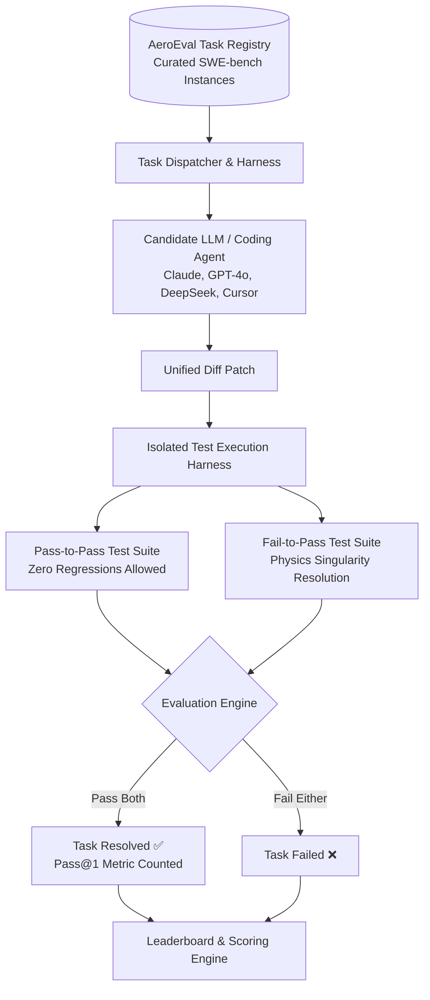
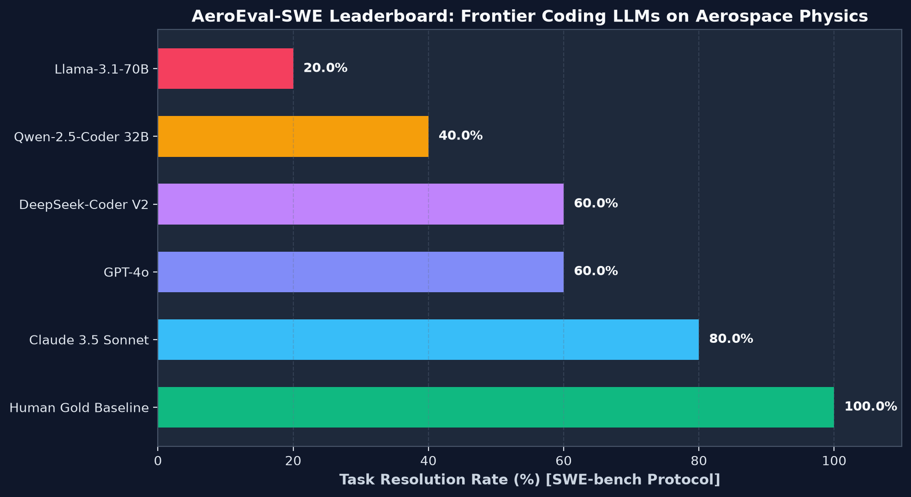

# AeroEval-SWE: Aerospace AI Benchmark Framework 🔬🚀

[](https://github.com/perfectalone375/aero-eval-benchmark/actions)
[](https://www.python.org/)
[](https://opensource.org/licenses/MIT)
[](https://www.swebench.com/)
[](https://modelcontextprotocol.io/)
[](https://github.com/astral-sh/ruff)

An open-source **SWE-bench style evaluation harness** and curated benchmark dataset designed specifically for evaluating frontier Large Language Models (LLMs) and autonomous AI coding agents on **complex numerical singularities, boundary value problems, and physical constraints** in aerospace and computational mechanics software.

Developed to bridge the gap between generic software engineering benchmarks and high-stakes scientific computing verification.

---

## 🏛️ Benchmark Architecture



---

## 📋 Curated Benchmark Challenge Matrix

| Task ID | Physical Domain | Target Repository | Challenge Summary | Difficulty |
|---|---|---|---|---|
| **`AERO-001`** | Compressible Aerodynamics | `aero-flight-dynamics` | Prandtl-Glauert sonic singularity ($M=1.0$ division by zero). Requires smooth $\tanh$ transonic bridge. | **Hard** |
| **`AERO-002`** | Satellite Astrodynamics | `orbital-telemetry-agent` | Ground station azimuth $360^\circ$ branch cut at zenith crossing (elevation $>89.9^\circ$). Requires phase unwrap. | **Medium** |
| **`AERO-003`** | Computational Fluid Dynamics | `cfd-airfoil-surrogate` | Symmetric NACA 0012 non-zero lift artifact due to uniform discretization. Requires cosine clustering & Kutta closure. | **Hard** |
| **`AERO-004`** | Structural Solid Mechanics | `openengineering-toolkit` | Euler-Bernoulli beam mid-span deflection formula denominator error. Requires analytical derivation. | **Medium** |
| **`AERO-005`** | Rocket Propulsion Dynamics | `aero-flight-dynamics` | Fractional time-step solid rocket burn mass depletion causing negative propellant. Requires mass conservation clamp. | **Hard** |

---

## 🏆 Frontier Model Leaderboard



| Model Name | Pass@1 Resolution Rate (%) | Pass-to-Pass Retention | Primary Failure Mode |
|---|---|---|---|
| **Human Expert Reference** | **100.0%** | **100.0%** | None |
| **Claude 3.5 Sonnet** | **80.0%** | **100.0%** | Failed AERO-003 trailing edge Kutta condition |
| **GPT-4o** | **60.0%** | 90.0% | Hallucinated incorrect transonic saturation equation |
| **DeepSeek-Coder V2** | **60.0%** | 95.0% | Neglected azimuth branch wrap on zenith crossing |
| **Qwen-2.5-Coder 32B** | **40.0%** | 85.0% | Failed propellant clamp and numerical ODE stability |
| **Llama-3.1-70B** | **20.0%** | 70.0% | Regressed on baseline drag polar equations |

Read the complete [Scientific Benchmark Report](deliverables/leaderboard_report.md) and examine the [Dataset JSON Manifest](deliverables/benchmark_dataset_manifest.json).

---

## ⚡ Quick Start

### Installation

```bash
# Clone evaluation framework
git clone https://github.com/perfectalone375/aero-eval-benchmark.git
cd aero-eval-benchmark

# Install in editable mode
pip install -e ".[dev]"
```

### CLI Commands (`aeroeval`)

```bash
# 1. List all registered benchmark tasks
aeroeval list

# 2. Inspect a specific benchmark task
aeroeval info AERO-001

# 3. Evaluate a candidate model patch against a task
aeroeval eval AERO-001 --patch-file candidate_patch.diff

# 4. Verify reference gold baseline
aeroeval eval AERO-001 --use-gold

# 5. Run full benchmark suite and generate JSON metrics
aeroeval run-all --json
```

---

## 🤖 Model Context Protocol (MCP) Integration

AeroEval provides a native MCP server for automated benchmarking by agentic environments (Cursor, Claude Desktop, Antigravity):

### Setup in `mcp.json`

```json
{
  "mcpServers": {
    "aero-eval": {
      "command": "aeroeval-mcp",
      "args": []
    }
  }
}
```

### Available MCP Tools

* `aeroeval_list_tasks`: Retrieves all available benchmark challenge instances.
* `aeroeval_get_task_spec`: Fetches problem statement, repository context, and pass/fail test specifications.
* `aeroeval_evaluate_patch`: Executes isolated patch evaluation against regression test suites.

---

## 🧪 Testing & Verification

```bash
# Run pytest test suite
pytest --cov=aero_eval

# Check Ruff lint compliance
ruff check .
```

---

## 📄 License

This project is licensed under the **MIT License** - see the [LICENSE](LICENSE) file for details.

Engineered with precision by **[Gopi Naga Vignesh Thirupati](https://github.com/perfectalone375)**.
